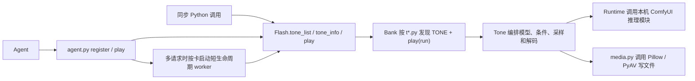

# ComfyFlash v0.2 差异盘点

工单 CF-2026-1121-01，基线 `86c9f70a67680fe6fcfd146327463d522738780e`，2026-11-21。开始前 `main` 与 `origin/main` 一致，工作区干净。在本地 `dev/v0.2` 验证变更。基线 27 项测试通过。

## 架构与入口

注册通过 `tone_list()` 和 `tone_info()` 检查已有权重和 Python/CUDA。CLI 公开命令只有 register、download-models 和 play。项目 Skill 按注册结果派发请求，已包含 H3 视频和图像指南，但正文仍固定列出四个 Tone。模型、LoRA 与文档归属保留在 Tone。

## 核对结果

| 工单项 | 状态 | 基线行为 |
| --- | --- | --- |
| Bank 与用户接口 | 已存在 | Bank 自动导入带 TONE 和 play 的模块。Python 入口返回列表、完整定义或单次结果。注册依赖表覆盖当前官方权重，第三方 Tone 的本地权重状态仍需独立处理。 |
| 能力契约与 CLI 发现 | 部分 | 字典已有模型、参数范围及默认值。缺类型、版本、Schema、跨参数组合和硬件/时长信息的统一表示。CLI 没有只读目录命令。 |
| 预检 | 部分 | 核对必需字段、文件路径、分辨率、部分采样参数和模型是否存在。支持一张图的 Tone 收到多张图时只取第一张。显式分辨率下的参考图到推理路径才打开。 |
| 视频时间 | 部分 | `Flash._resolve` 按 24 fps 将秒换成整数帧，再向上对齐到 17n+5。VAE 多解的帧被截断，结果只报告交付时长、交付帧数及不匹配备注。 |
| 资源路径 | 部分 | 动态显存路径依赖 AIMDO。旧式路径在第一次视频/音频解码前主动 offload。缓存可在同一 Flash 实例或 worker 内复用，CLI 退出后随进程释放。 |
| 批量结果与恢复 | 部分 | 每个 worker 可先输出完成票据，父进程使用 `subprocess.run(capture_output=True)` 汇总。按轮转分配请求，按原索引返回。异步读取故障可在新进程重试未完成任务。现有准入主要看总/空闲显存和 16 GiB 可用 RAM 下限。 |
| Artifact、观察材料、音频检查 | 缺失 | 成功对象有 file、tone、seed、elapsed_s、宽高。视频还有 frames、duration、fps、sampling、runtime、timing_s。无旁车、帧拼图、尾帧或音轨技术报告。 |
| 原子输出 | 缺失 | Pillow 与 PyAV 直接打开最终路径，旧文件可能覆盖，编码中断可留下不完整文件。 |
| P2 与 P3 | 本轮暂缓 | 维持父进程批量汇总。保留已验证的 T2VA、单图 Ref2VA、文生图和单图编辑接口。 |

## 兼容决定

保留 Python 与 CLI 原入口、已有的结果字段、旧配置和四个模型配方。时间与 Artifact 使用增量字段。H3 的默认 6 步 Pika 及历史采样参数组合分别测试。合法的单参考路径和单元素列表继续可用。多图请求是工单指定的校验修复，返回数量和上限。输出文件存在时默认返回冲突，显式 `overwrite=true` 可延续覆盖用法。编码临时文件在 Windows 占用导致发布失败时提供恢复路径。旁车成功写入才表示完整交付。

## 环境与风险

| 项目 | 当前实机环境 |
| --- | --- |
| ComfyUI | `0228a9d73cd7c2daf8f61fe13d56b12efe307171` |
| 推理环境 | Python 3.13.14，Torch 2.13.0+cu130，驱动 621.14，PyAV 18.0.0 |
| 库 | Pillow 12.3.0，NumPy 2.5.1，safetensors 0.8.0，comfy-aimdo 0.6.0，comfy-kitchen 0.2.41，SageAttention 1.0.6，psutil 7.2.2 |
| 机器 | Windows WDDM，两块 RTX 5060 Ti 16 GiB，约 48 GiB RAM |

PyAV 的流帧数和时长字段随封装格式变化。验证预期帧数需能降级到包级探测，观察图优先取解码后已有的帧。需要区分有意的黑帧或静音与文件损坏。AAC 编码会带来填充/尾部差异，分别记录分析采样与容器信息。Windows 显存依旧需要按 GPU UUID 使用实测设备空闲量。AIMDO 与旧模式的 Python 对象、磁盘映射、GPU 内存生命周期不同，先测阶段峰值再决定优化。对大型权重记录明确标注算法的低成本内容指纹，完整 SHA-256 可由已验证的下载记录证明。

## 实施顺序与验证

1. **P0 能力契约。** 在 `engine/bank` 为各 Tone 声明输入、媒体输出、依赖、时间网格与预设。共用验证定义，增加按需 Schema。通过 `engine/core.py` 和 `engine/agent.py` 提供动态发现和无推理预检。更新 Skill。用临时 Tone 检查接入，用不合法请求确认模型加载函数未执行。
2. **P0 时间。** 明确请求秒数、舍入前的意图、对齐目标、解码帧数、实际交付和裁剪量。覆盖 5 秒及自定义视频时间网格。对非 24 fps 的现有 H3 请求返回明确错误。
3. **P1 交付。** 在当前媒体层验证、发布媒体和旁车。通过 Tensor 上的均匀采样生成 Contact Sheet 和尾帧。使用真实 PNG 和 MP4/MOV/MKV 小片验证封装、音频、缺流与损坏文件。覆盖已存在目标、Windows 文件占用路径及失败后重复提交。
4. **P1 资源。** 使用同机同种子检查动态/旧式路径和解码前卸载实验。比较批次冷/热加载、RAM 和设备显存，基于数据评估模型亲和与错峰策略。保持结果及重试按原索引对应。真实 GPU 验证 t1–t4、长短视频时间、观察包、原生音轨和双卡调度可达性。
5. 在 `docs/CF_V02_API.md` 和 `docs/CF_V02_TEST_REPORT.md` 分别记录接口与结果。表内区分测试桩、真实媒体和真实 GPU。观察到的计时波动与确证的加速分别报告。

## RSI 与硬件经验增量盘点

2026-11-22，适用 RSI 独立模块与 SQLite 版工单。收到工单时 `dev/v0.2` 已完成初版契约，产物交付和多卡资源验证正在进行。基线执行日志至多随详细模式在结果中返回，失败结果缺少阶段、设备标识和资源快照。现有注册能力能读取显存和 RAM，尚未输出每次自动选卡决定和理由。

| 层级 | P0/P1 变更 | 后续阶段 |
| --- | --- | --- |
| 任务 | 发现 Tone，执行请求，通过文件与 Artifact 衔接，按观察包决定局部重跑。 | Plan 预检、计划版本与持久化恢复。 |
| 执行策略 | 记录实际配置、时间、资源、失败阶段和复跑证据，使用确定性准入。 | 建立画像、经济区间和有样本依据的异构 GPU 推荐。 |
| 改进机制 | 独立 SQLite 保存小型任务摘要、提案、实验、策略版本和回退依据。 | 人工审查的基线/候选对比，证据充分后的限域采纳。 |

`RSI/` 只接收 Engine 的任务结束摘要。Python 同步入口按调用记录，多进程 CLI 由父进程批量落盘。每次尝试的详细记录保存在独立 JSONL，媒体仍通过文件和旁车交付。数据库默认位于 `RSI/data/rsi.sqlite3`，配置可指定其他本地磁盘路径。预检、注册和采样循环均无需数据库连接。写入故障返回警告，准入及推理路径继续使用内置策略。测试覆盖重复初始化、迁移保留数据、忙锁、并发写、备份恢复及生成后遇到损坏数据库的隔离行为。
